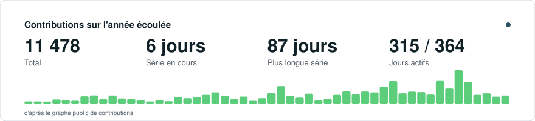

Des outils et des agents IA pour [Mindustry](https://github.com/Anuken/Mindustry), plus un bot Discord.

---

## Ce qui est public

### ⚒️ [mindustry-forge](https://github.com/yamakajump/mindustry-forge)

Une bibliothèque de schémas où chaque chiffre a été mesuré en faisant tourner le jeu, pas
annoncé par celui qui l'a publié. Recherche, banc d'essai et un classement que tout le monde
peut vérifier. En ligne sur [mindustryforge.com](https://mindustryforge.com).

### 🤖 [mindustry-ai](https://github.com/yamakajump/mindustry-ai)

C'est là qu'est le problème intéressant. Mindustry est un jeu de tower defense industriel, et
y gagner demande trois choses qui cohabitent rarement : une économie à long terme, du
raisonnement spatial sur une grille, et du combat réactif. Factorio a son environnement
d'apprentissage. StarCraft II a pysc2. Mindustry n'avait rien, alors je le construis : un mod
JVM qui expose l'état du jeu, un environnement Gymnasium par-dessus, et un lecteur de replay
qui rejoue les entraînements dans le vrai client du jeu.

### 🐯 [EDT-discord-bot](https://github.com/yamakajump/EDT-discord-bot)

Fait tourner une communauté musculation. Les membres versent l'export de leur salle, le bot
en tire des heatmaps et des séries, calcule leurs macros et leur 1RM, et les fait progresser
en rôles à mesure qu'ils viennent. Une cinquantaine de commandes slash, MySQL, Docker,
déployé par GitHub Actions.

---

## Stack

Dart et Flutter pour le mobile. PHP et Laravel pour les API. TypeScript et React pour le web.
Node et Python pour tout le reste. Déployé avec Docker sur des serveurs que j'administre moi-même.

---

## Activité

<picture>
  <source media="(prefers-color-scheme: dark)" srcset="https://raw.githubusercontent.com/yamakajump/yamakajump/output/stats-fr-dark.svg" />
  <source media="(prefers-color-scheme: light)" srcset="https://raw.githubusercontent.com/yamakajump/yamakajump/output/stats-fr-light.svg" />
  
</picture>

<picture>
  <source media="(prefers-color-scheme: dark)" srcset="https://github-readme-activity-graph.vercel.app/graph?username=yamakajump&theme=github-dark&hide_border=true&area=true&radius=8" />
  <source media="(prefers-color-scheme: light)" srcset="https://github-readme-activity-graph.vercel.app/graph?username=yamakajump&theme=github-light&hide_border=true&area=true&radius=8" />
  
</picture>

<picture>
  <source media="(prefers-color-scheme: dark)" srcset="https://raw.githubusercontent.com/yamakajump/yamakajump/output/snake-dark.svg" />
  <source media="(prefers-color-scheme: light)" srcset="https://raw.githubusercontent.com/yamakajump/yamakajump/output/snake.svg" />
  
</picture>

