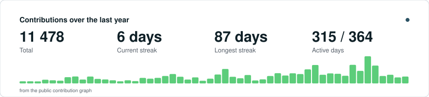

Tools and AI agents for [Mindustry](https://github.com/Anuken/Mindustry), plus a Discord bot.

---

## What is public

### ⚒️ [mindustry-forge](https://github.com/yamakajump/mindustry-forge)

A schematic library where every number was measured by running the game, not claimed by
whoever uploaded it. Search, bench and a leaderboard anyone can check. Live at
[mindustryforge.com](https://mindustryforge.com).

### 🤖 [mindustry-ai](https://github.com/yamakajump/mindustry-ai)

This is where the interesting problem is. Mindustry is a factory-building tower defense game,
and winning it needs three things that rarely appear together: long-horizon economics, spatial
reasoning on a grid, and reactive combat. Factorio has a learning environment. StarCraft II has
pysc2. Mindustry had nothing, so I am building it: a JVM mod that exposes game state, a
Gymnasium environment on top, and a replay viewer that renders training runs inside the real
game client.

### 🐯 [EDT-discord-bot](https://github.com/yamakajump/EDT-discord-bot)

Runs a French fitness community. Members upload their gym export, the bot turns it into
heatmaps and streaks, computes their nutrition and one-rep-max numbers, and promotes them
through roles as they show up. Around fifty slash commands, MySQL, Docker, deployed by
GitHub Actions.

---

## Stack

Dart and Flutter for mobile. PHP and Laravel for APIs. TypeScript and React for the web.
Node and Python for everything else. Deployed with Docker on servers I administer myself.

---

## Activity

<picture>
  <source media="(prefers-color-scheme: dark)" srcset="https://raw.githubusercontent.com/yamakajump/yamakajump/output/stats-en-dark.svg" />
  <source media="(prefers-color-scheme: light)" srcset="https://raw.githubusercontent.com/yamakajump/yamakajump/output/stats-en-light.svg" />
  
</picture>

<picture>
  <source media="(prefers-color-scheme: dark)" srcset="https://github-readme-activity-graph.vercel.app/graph?username=yamakajump&theme=github-dark&hide_border=true&area=true&radius=8" />
  <source media="(prefers-color-scheme: light)" srcset="https://github-readme-activity-graph.vercel.app/graph?username=yamakajump&theme=github-light&hide_border=true&area=true&radius=8" />
  
</picture>

<picture>
  <source media="(prefers-color-scheme: dark)" srcset="https://raw.githubusercontent.com/yamakajump/yamakajump/output/snake-dark.svg" />
  <source media="(prefers-color-scheme: light)" srcset="https://raw.githubusercontent.com/yamakajump/yamakajump/output/snake.svg" />
  
</picture>

